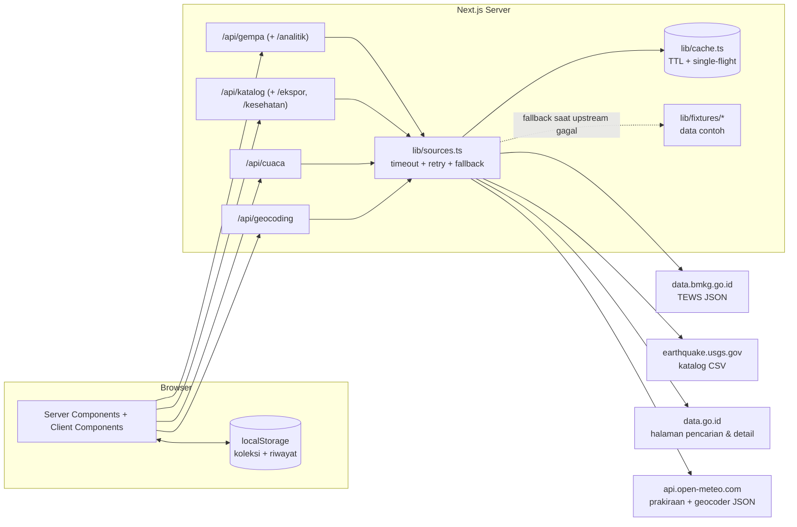
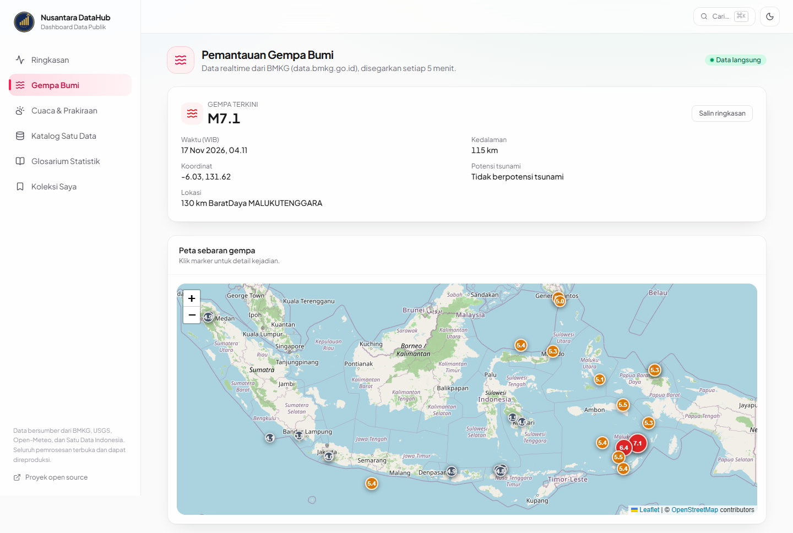
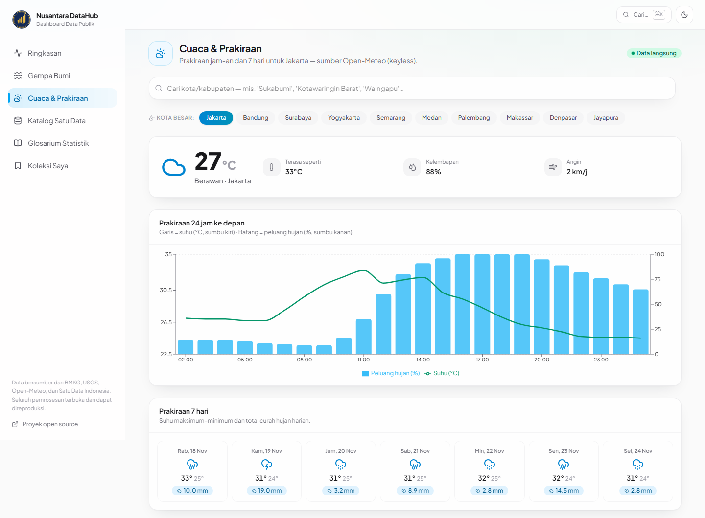
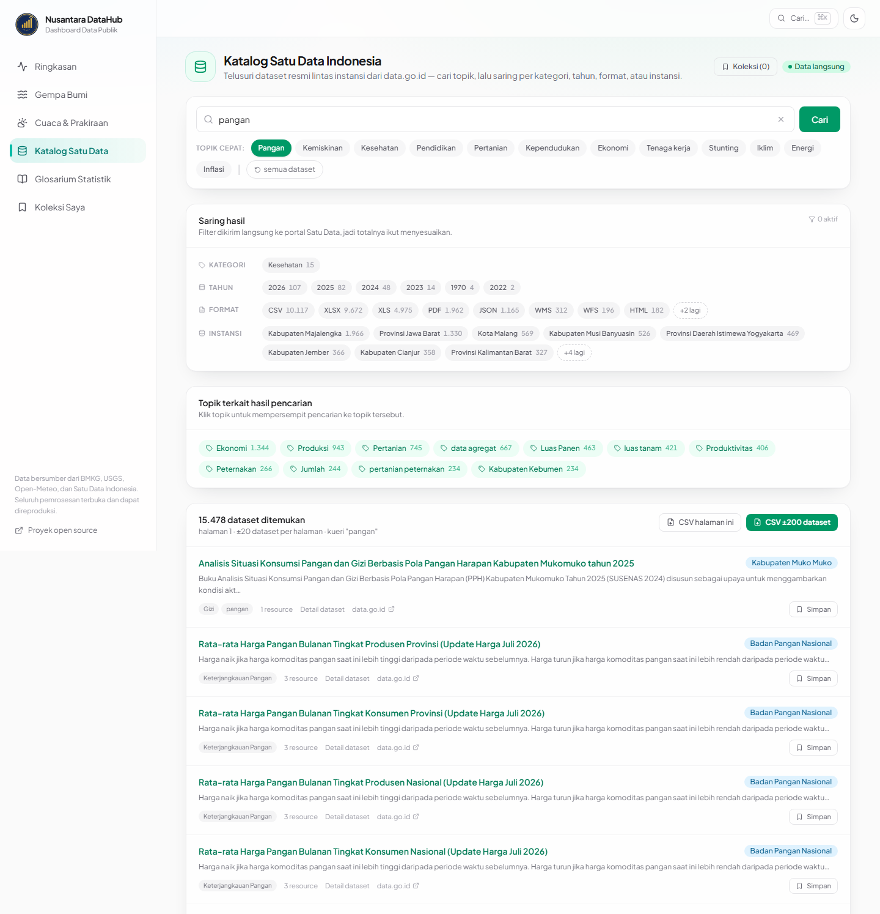
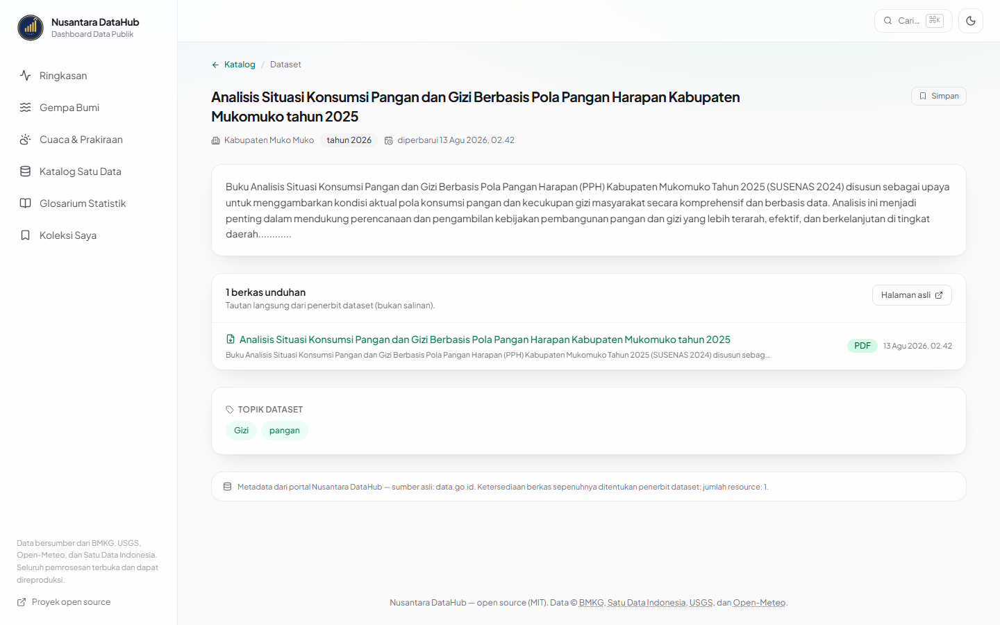
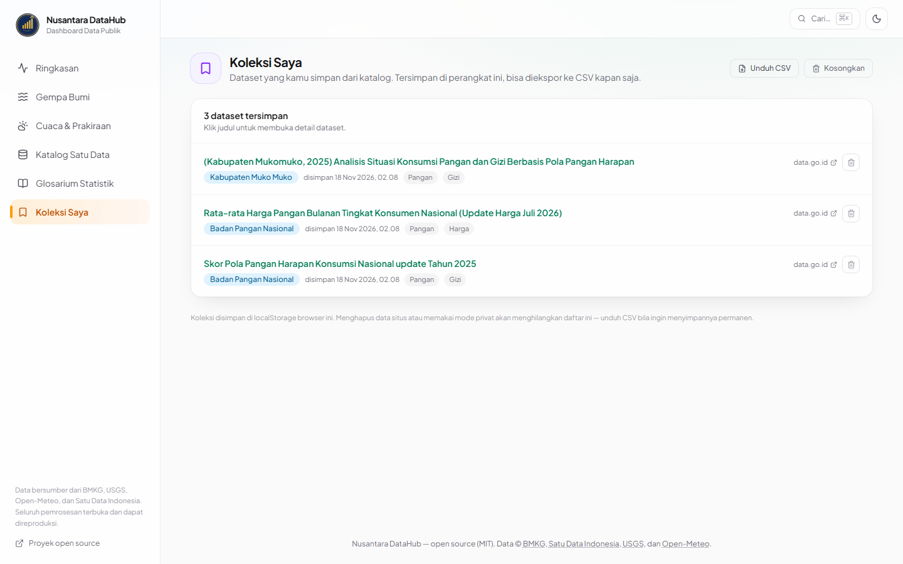

# Nusantara DataHub 🇮🇩

**Dashboard terpadu data publik Indonesia** — gempa bumi BMKG, katalog dataset Satu Data Indonesia, prakiraan cuaca, dan glosarium statistik, digabung dalam satu aplikasi web open source.

> 🔴 **Demo langsung:** [https://nusantara-datahub.netlify.app](https://nusantara-datahub.netlify.app)

> Proyek ini lahir dari temuan riset bahwa belum ada dashboard OSS lintas sumber untuk data pemerintah Indonesia: lapisan wrapper API-nya ramai (stadata, PyBMKG, dsb.), tapi lapisan antarmuka analisis yang menyatukannya masih kosong.

[](https://nusantara-datahub.netlify.app)
[](https://nextjs.org)
[](https://www.typescriptlang.org)

## Fitur

| Modul | Sumber | Key? | Isi |
|---|---|---|---|
| 🧭 **Ringkasan** | agregasi semua modul | tidak perlu | Satu layar berisi KPI lintas sumber (gempa terkini, kejadian gempa 90 hari, dataset terindeks, cuaca Jakarta), pencarian topik yang langsung membuka katalog, kartu ringkas tiap modul, dan tabel status sumber data |
| 🌊 **Gempa Bumi** | [BMKG TEWS](https://data.bmkg.go.id/DataMKG/TEWS/gempaterkini.json) + [USGS FDSN](https://earthquake.usgs.gov/fdsnws/event/1/) | tidak perlu | Gempa terkini M≥5,0, gempa dirasakan (skala MMI), peta sebaran interaktif Leaflet, shakemap BMKG, **analitik 90 hari** (histogram magnitude, sebaran per wilayah, tren harian), tombol salin ringkasan |
| 🌦️ **Cuaca & Prakiraan** | [Open-Meteo](https://open-meteo.com) (prakiraan + geocoder) | tidak perlu | Prakiraan jam-an 24 jam dan 7 hari untuk **seluruh kota/kabupaten Indonesia** (pencarian geocoding berbahasa Indonesia, hasil dibedakan per provinsi), akses cepat 10 kota besar, riwayat tempat tersimpan lokal |
| 🗂️ **Katalog Satu Data** | [payload data.go.id](https://data.go.id/dataset) | tidak perlu | Pencarian 747rb+ dataset resmi lintas instansi, **topik cepat** (pangan, kemiskinan, stunting, …) dan **topik terkait** dari facet tag, **filter facet** kategori/tahun/format/instansi yang dikirim langsung ke portal, **halaman detail dataset** dengan berkas unduhan, **ekspor CSV** (halaman ini atau ±200 dataset), paginasi dengan lompat-halaman, riwayat & saran kueri |
| 📌 **Koleksi Saya** | `localStorage` perangkat | tidak perlu | Bookmark dataset dari katalog/detail, tersimpan lokal tanpa server, ekspor koleksi ke CSV |
| 📖 **Glosarium Statistik** | data statis di repo | tidak perlu | 46 istilah statistik: penjelasan bahasa awam, rumus, contoh — pencarian + filter kategori |

### Unggulan desain

- **Graceful degradation yang jujur** — upstream mati/tidak terjangkau? Halaman tetap berfungsi memakai data contoh bawaan, ditandai badge *"Data contoh (fallback)"* agar pengguna tidak keliru menganggapnya data live.
- **Pencarian katalog yang tahan gangguan portal** — halaman data.go.id kadang dibalas "cangkang" tanpa data (HTTP 200). Validasi payload membedakan cangkang dari hasil kosong sah, lalu permintaan diulang; hasil kosong palsu tidak pernah masuk cache.
- **Semua upstream lewat proxy server** (route handlers Next.js) — tanpa masalah CORS, dengan cache in-memory ber-TTL + *single-flight* agar satu kueri populer tidak menembak portal berkali-kali.
- **Normalizer murni + test** — parsing data mentah BMKG dan payload Satu Data diisolasi sebagai fungsi pure ber-fixture; `npm test` menjalankan 12 tes tanpa jaringan.
- **⌘K / Ctrl+K command palette** — lompat ke modul mana pun atau langsung mencari topik di katalog.
- **PWA ringan + SEO** — manifest, service worker, `sitemap.xml`, `robots.txt`, JSON-LD `Dataset` pada halaman detail, dan metadata per halaman.
- **Desain Soft Modern**: font [Plus Jakarta Sans](https://fonts.google.com/specimen/Plus+Jakarta+Sans) (dirancang perancang Indonesia), kartu efek kaca (`backdrop-blur`), sistem aksen warna per modul (gempa=rose, cuaca=sky, katalog=emerald, glosarium=violet, koleksi=amber), dan animasi angka *count-up*.
- **Dark mode** berbasis `next-themes`, UI responsif berbahasa Indonesia (sidebar di desktop, bottom-nav di ponsel).

## Arsitektur



## Memulai

Prasyarat: **Node.js ≥ 20** dan npm.

```bash
# 1. clone
git clone https://github.com/zhabyanrafnannq/nusantara-datahub.git
cd nusantara-datahub

# 2. install
npm install

# 3. jalankan
npm run dev        # http://localhost:3000
```

Tidak ada environment variable yang wajib — semua modul berjalan tanpa API key.

Perintah lain:

| Perintah | Fungsi |
|---|---|
| `npm run dev` | Development server |
| `npm run build` | Build produksi |
| `npm run start` | Jalankan hasil build produksi |
| `npm test` | 12 tes parser/cache/CSV (tanpa jaringan, memakai fixture HTML asli portal) |

## Struktur proyek

```
├─ app/
│  ├─ page.tsx                  # Ringkasan: KPI lintas modul + pencarian topik + status sumber
│  ├─ gempa/page.tsx            # Modul gempa (hero + peta + tabel + analitik 90 hari)
│  ├─ cuaca/page.tsx            # Prakiraan cuaca Open-Meteo (geocoding semua kota/kabupaten)
│  ├─ katalog/page.tsx          # Pencarian + filter facet + ekspor CSV + paginasi
│  ├─ katalog/[slug]/page.tsx   # Detail dataset: metadata, berkas unduhan, JSON-LD
│  ├─ koleksi/page.tsx          # Bookmark dataset (localStorage) + ekspor koleksi
│  ├─ glosarium/page.tsx        # Kamus istilah statistik EN-ID
│  ├─ manifest.ts / robots.ts / sitemap.ts        # PWA + SEO
│  ├─ icon.svg                  # Favicon (logo mark)
│  └─ api/{gempa,katalog,cuaca,geocoding}/…       # Proxy + cache + fallback
├─ components/                  # UI: peta Leaflet, tabel, chart Recharts, command palette, primitif
├─ lib/
│  ├─ sources.ts                # Lapisan service: fetch upstream, timeout, fallback
│  ├─ bmkg.ts / ckan.ts / weather.ts / usgs.ts / glossary.ts   # Normalizer pure (tertest)
│  ├─ cache.ts                  # Cache TTL + deduplikasi permintaan paralel
│  ├─ katalog-limits.ts         # Batas halaman katalog (dipakai API + UI)
│  ├─ katalog-params.ts / katalog-history.ts / koleksi.ts      # Query, riwayat, bookmark
│  ├─ topics.ts                 # Daftar topik populer lintas modul
│  ├─ indonesia-map.ts          # Siluet kepulauan untuk logo (Natural Earth, domain publik)
│  ├─ types.ts                  # Tipe domain
│  └─ fixtures/                 # Data contoh realistis (fallback)
├─ public/sw.js                 # Service worker (PWA)
├─ tests/                       # Tes parser + fixture HTML asli portal
└─ netlify.toml                 # Konfigurasi deploy (plugin nextjs, Node 22)
```

## Screenshot

| | |
|---|---|
|  |  |
|  |  |
|  |  |
|  |  |

## Deployment

Repositori ini sudah berisi `netlify.toml` (plugin `@netlify/plugin-nextjs`, Node 22).

- **Netlify**: Import repo di [app.netlify.com](https://app.netlify.com) → deploy otomatis, tanpa environment variable.
- **VPS/Docker**: `npm run build && npm run start`, gunakan reverse proxy (Nginx/Caddy).

## Atribusi sumber data

| Sumber | Ketentuan |
|---|---|
| [BMKG](https://www.bmkg.go.id) | Data gempa © BMKG, digunakan untuk tujuan non-komersial dengan atribusi |
| [Satu Data Indonesia](https://data.go.id) | Portal data terbuka pemerintah (diakses via halaman publik portal) |
| [USGS](https://earthquake.usgs.gov) | Katalog gempa global, domain publik |
| [Open-Meteo](https://open-meteo.com) | Prakiraan cuaca, lisensi CC BY 4.0 |
| [Natural Earth](https://github.com/nvkelso/natural-earth-vector) | Siluet peta pada logo, domain publik |

Proyek ini **bukan** produk resmi BMKG, Satu Data Indonesia, USGS, maupun Open-Meteo. Data tetap tunduk pada ketentuan lembaga penerbit.

## Roadmap

- [x] Filter facet katalog (kategori, tahun, format, instansi) langsung ke portal
- [x] Halaman detail dataset + berkas unduhan + JSON-LD
- [x] Koleksi/bookmark dataset dan ekspor CSV multi-halaman
- [x] PWA (manifest + service worker), sitemap, robots, command palette ⌘K
- [ ] Cuaca resmi BMKG (api.bmkg.go.id) sebagai opsi tambahan ber-key
- [ ] Analitik gempa: filter rentang magnitude & wilayah interaktif
- [ ] Pengayaan glosarium: 100+ istilah + contoh soal
- [ ] Cache persisten (SQLite) agar offline-mode lebih lama
- [ ] i18n EN

---

**English (short).** Nusantara DataHub is an open-source dashboard unifying Indonesia's public data: real-time earthquakes (BMKG + USGS analytics), weather forecasts for every Indonesian regency (Open-Meteo), and the national open-data catalog (Satu Data) with faceted search, dataset detail pages, saved collections and CSV export. Built with Next.js 15 + TypeScript; every upstream call goes through server-side proxies with per-source caching and an honest "sample data" fallback when the upstream is unreachable. **Live demo:** https://nusantara-datahub.netlify.app
