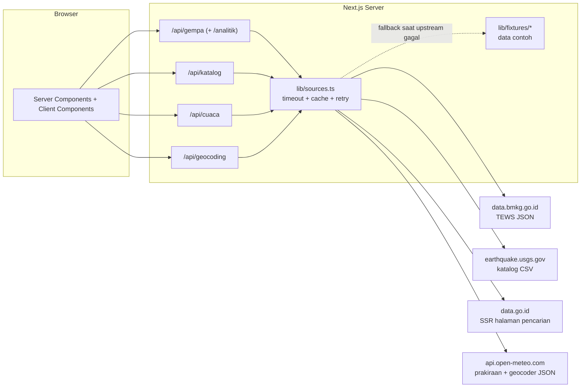
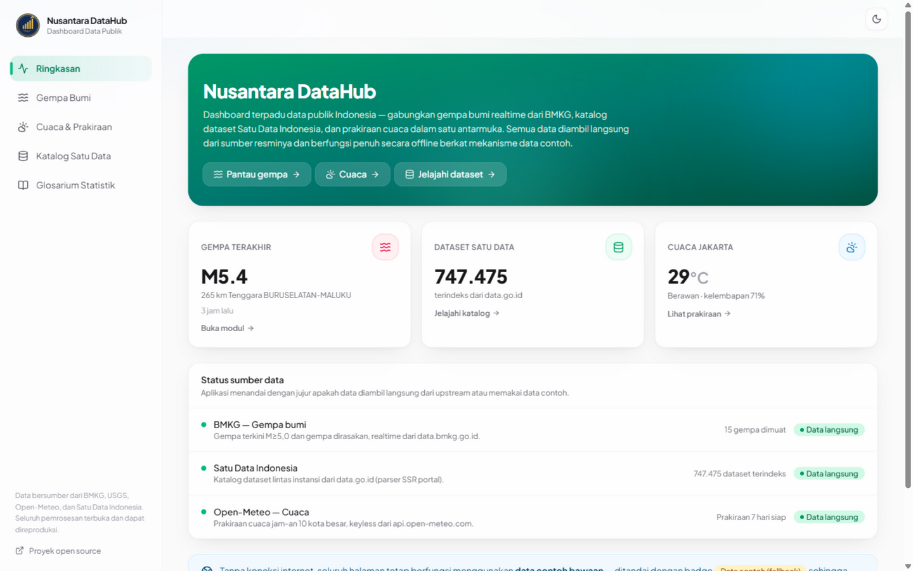
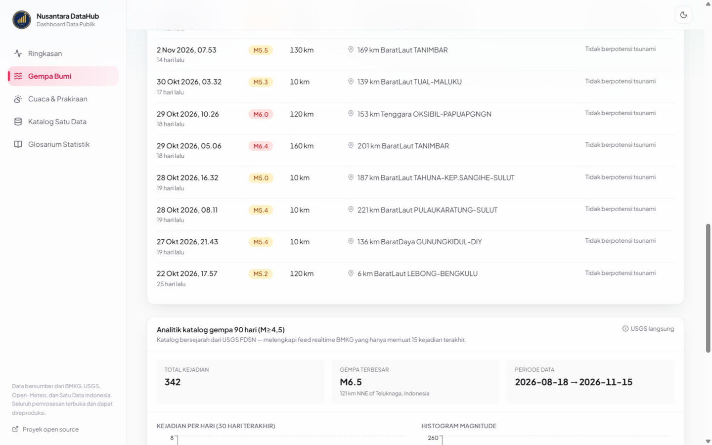
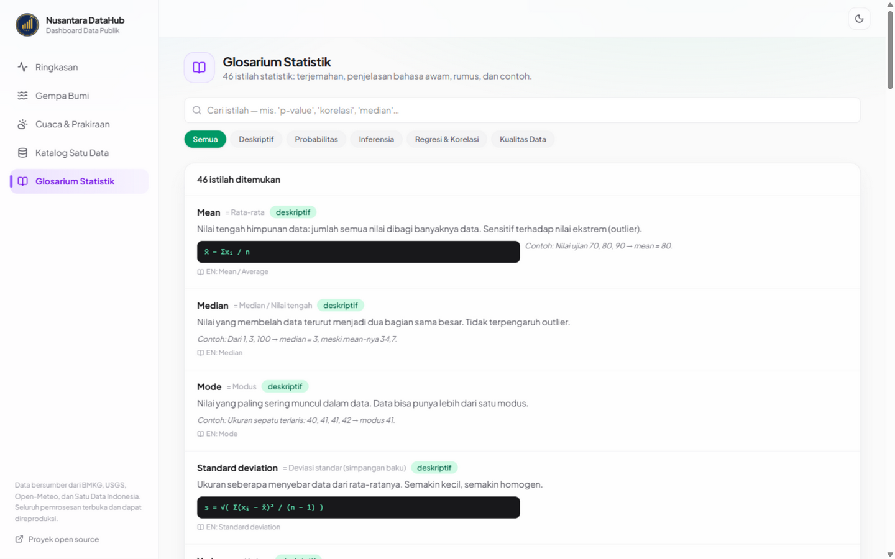

# Nusantara DataHub 🇮🇩

**Dashboard terpadu data publik Indonesia** — gempa bumi BMKG, katalog dataset Satu Data Indonesia, dan prakiraan cuaca, digabung dalam satu aplikasi web open source.

> 🔴 **Demo langsung:** [https://nusantara-datahub.netlify.app](https://nusantara-datahub.netlify.app)

> Proyek ini lahir dari temuan riset bahwa belum ada dashboard OSS lintas sumber untuk data pemerintah Indonesia: lapisan wrapper API-nya ramai (stadata, PyBMKG, dsb.), tapi lapisan antarmuka analisis yang menyatukannya masih kosong.

[](https://nusantara-datahub.netlify.app)
[](https://nextjs.org)
[](https://www.typescriptlang.org)

## Fitur

| Modul | Sumber | Key? | Isi |
|---|---|---|---|
| 🌊 **Gempa Bumi** | [BMKG TEWS](https://data.bmkg.go.id/DataMKG/TEWS/gempaterkini.json) + [USGS FDSN](https://earthquake.usgs.gov/fdsnws/event/1/) | tidak perlu | Gempa terkini M≥5,0, gempa dirasakan (skala MMI), peta sebaran interaktif Leaflet, shakemap BMKG, **analitik 90 hari** (histogram magnitude, sebaran per wilayah, tren harian), tombol salin ringkasan |
| 🌦️ **Cuaca & Prakiraan** | [Open-Meteo](https://open-meteo.com) (prakiraan + geocoder) | tidak perlu | Prakiraan jam-an 24 jam dan 7 hari untuk **seluruh kota/kabupaten Indonesia** (pencarian geocoding berbahasa Indonesia, hasil dibedakan per provinsi), akses cepat 10 kota besar, riwayat tempat tersimpan lokal |
| 🗂️ **Katalog Satu Data** | [SSR data.go.id](https://data.go.id/dataset) | tidak perlu | Pencarian ribuan dataset resmi lintas instansi (747rb+ terindeks), topik populer (klik = filter), paginasi, **ekspor CSV** |
| 📖 **Glosarium Statistik** | data statis di repo | tidak perlu | 46 istilah statistik: penjelasan bahasa awam, rumus, contoh — pencarian + filter kategori |

### Unggulan desain

- **Graceful degradation yang jujur** — upstream mati/tidak terjangkau? Halaman tetap berfungsi memakai data contoh bawaan, ditandai badge *"Data contoh (fallback)"* agar pengguna tidak keliru menganggapnya data live.
- **Semua upstream lewat proxy server** (route handlers Next.js) — tanpa masalah CORS, dan respons di-cache dengan durasi yang sesuai tiap sumber (5 menit hingga 1 jam).
- **Normalizer murni + test** — parsing data mentah BMKG dan SSR Satu Data diisolasi sebagai fungsi pure ber-fixture, diuji tanpa jaringan.
- **Desain Soft Modern**: font [Plus Jakarta Sans](https://fonts.google.com/specimen/Plus+Jakarta+Sans) (dirancang perancang Indonesia), kartu efek kaca (`backdrop-blur`), sistem aksen warna per modul (gempa=rose, cuaca=sky, katalog=emerald, glosarium=violet), dan animasi angka *count-up*.
- **Dark mode** berbasis `next-themes`, UI responsif berbahasa Indonesia.

## Arsitektur



## Memulai

Prasyarat: **Node.js ≥ 20** dan npm.

```bash
# 1. clone
git clone https://github.com/zhabyanrafnannq/nusantara-datahub.git
cd nusantara-datahub

# 2. install
npm install

# 3. jalankan
npm run dev        # http://localhost:3000
```

Tidak ada environment variable yang wajib — semua modul berjalan tanpa API key.

Perintah lain:

| Perintah | Fungsi |
|---|---|
| `npm run dev` | Development server |
| `npm run build` | Build produksi |
| `npm run start` | Jalankan hasil build produksi |

## Struktur proyek

```
├─ app/
│  ├─ page.tsx              # Ringkasan: kartu status sumber data
│  ├─ gempa/page.tsx        # Modul gempa (hero + peta + tabel + analitik 90 hari)
│  ├─ cuaca/page.tsx        # Prakiraan cuaca Open-Meteo (geocoding semua kota/kabupaten)
│  ├─ katalog/page.tsx      # Pencarian dataset Satu Data (parser SSR) + ekspor CSV
│  ├─ glosarium/page.tsx    # Kamus istilah statistik EN-ID
│  ├─ icon.svg              # Favicon (logo mark)
│  └─ api/{gempa,katalog,cuaca,geocoding}/route.ts   # Proxy + cache + fallback
├─ lib/
│  ├─ sources.ts            # Lapisan service: fetch upstream, timeout, fallback
│  ├─ bmkg.ts / ckan.ts / weather.ts / usgs.ts / glossary.ts   # Normalizer pure (tertest)
│  ├─ indonesia-map.ts      # Siluet kepulauan untuk logo (Natural Earth, domain publik)
│  ├─ types.ts              # Tipe domain
│  └─ fixtures/             # Data contoh realistis (fallback)
├─ components/              # UI: peta Leaflet, tabel, chart Recharts, logo, primitif
└─ netlify.toml             # Konfigurasi deploy (plugin nextjs, Node 22)
```

## Screenshot

| | |
|---|---|
|  |  |
|  |  |
|  |  |

## Deployment

Repositori ini sudah berisi `netlify.toml` (plugin `@netlify/plugin-nextjs`, Node 22).

- **Netlify**: Import repo di [app.netlify.com](https://app.netlify.com) → deploy otomatis, tanpa environment variable.
- **VPS/Docker**: `npm run build && npm run start`, gunakan reverse proxy (Nginx/Caddy).

## Atribusi sumber data

| Sumber | Ketentuan |
|---|---|
| [BMKG](https://www.bmkg.go.id) | Data gempa © BMKG, digunakan untuk tujuan non-komersial dengan atribusi |
| [Satu Data Indonesia](https://data.go.id) | Portal data terbuka pemerintah (diakses via halaman SSR publik) |
| [USGS](https://earthquake.usgs.gov) | Katalog gempa global, domain publik |
| [Open-Meteo](https://open-meteo.com) | Prakiraan cuaca, lisensi CC BY 4.0 |
| [Natural Earth](https://github.com/nvkelso/natural-earth-vector) | Siluet peta pada logo, domain publik |

Proyek ini **bukan** produk resmi BMKG, Satu Data Indonesia, USGS, maupun Open-Meteo. Data tetap tunduk pada ketentuan lembaga penerbit.

## Roadmap

- [ ] Cuaca resmi BMKG (api.bmkg.go.id) sebagai opsi tambahan ber-key
- [ ] Analitik gempa: filter rentang magnitude & wilayah interaktif
- [ ] Pengayaan glosarium: 100+ istilah + contoh soal
- [ ] Cache persisten (SQLite) agar offline-mode lebih lama
- [ ] i18n EN

---

**English (short).** Nusantara DataHub is an open-source dashboard unifying Indonesia's public data: real-time earthquakes (BMKG + USGS analytics), weather forecasts for every Indonesian regency (Open-Meteo), and the national open-data catalog (Satu Data). Built with Next.js 15 + TypeScript; every upstream call goes through server-side proxies with per-source caching and an honest "sample data" fallback when the upstream is unreachable. **Live demo:** https://nusantara-datahub.netlify.app
